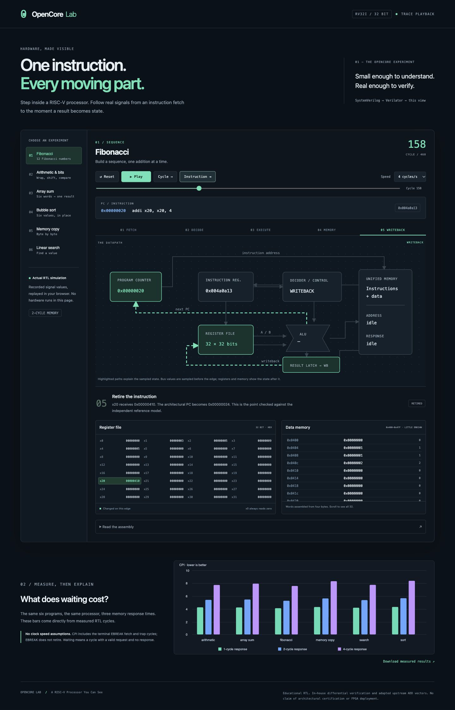
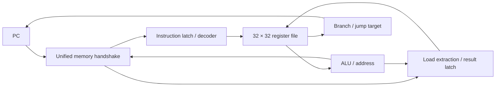

# OpenCore Lab: A RISC-V Processor You Can See

A small, synthesizable multi-cycle processor, an architectural checker, and a browser view of **real RTL simulation traces**. Explore how instructions move through fetch, decode, execute, memory and writeback, then measure what slower memory costs.



The teaching core implements the 40 RV32I base mnemonics with a terminal trap environment. It has no OS, pipeline, caches, CSRs or multiplication extension. It is not architecturally certified. [Instruction support and limitations](docs/instruction-support.md) define the exact scope.

## Quick start

Install Verilator 5.x, a C++20-capable compiler, Python 3.10+, Node 20+ and Make. The tested baseline is Verilator 5.052, Apple Clang 17, Python 3.14.7 and Node 26.5.0. [Setup and publication guide](docs/setup.md) includes macOS/Linux commands and version details.

```sh
make verify   # Compile RTL, test, benchmark, build and check the static demo
make serve    # Open http://127.0.0.1:8000
```

The demo requires no API keys, paid services, npm packages or external assets. `make demo` builds it from the included measured traces without an RTL toolchain. Publish `dist/` to any static host. A manual GitHub Pages workflow is included.

## What is inside

- **Hardware:** PC, strict decoder, 32-register file, ALU and a multi-cycle controller. Little-endian byte/halfword/word operations use a stable single-outstanding request/response interface, including variable memory delays and access errors.
- **Verification:** unit tests, directed edge cases, reproducible randomized programs, retirement-by-retirement comparison against an in-house Python interpreter, exact successful-store counts, trap checks and VCD waveforms.
- **Six programs:** arithmetic/bit operations, Fibonacci, array sum, bubble sort, byte copy and linear search. Readable assembly and a bounded two-pass assembler produce raw executable images.
- **Browser:** labeled datapath, current instruction/PC, active state and paths, registers with changes, reconstructed data memory, explanations, program selection, play/pause, speed, reset, cycle and instruction stepping.

## Verified results

On the tested local toolchain, the regression passed **12,155 unit checks**, **75 processor runs** and **2,234 differential retirement comparisons**, including **15 adapted upstream ADD vectors**. All six examples also have independent expected-output assertions. A separate **18-run RTL benchmark** checks every retirement and its cycle-accounting equation. A clean-source rebuild on the same host passed. Exact records: [verification JSON](results/verification.json), [reproduction record](results/reproduction.json), [browser QA](results/browser-qa.json).

| Program | Retired | Cycles at L=1 | L=2 | L=4 |
| --- | ---: | ---: | ---: | ---: |
| Arithmetic | 13 | 56 | 71 | 101 |
| Array sum | 35 | 150 | 193 | 279 |
| Fibonacci | 88 | 367 | 468 | 670 |
| Memory copy | 99 | 431 | 563 | 827 |
| Search | 33 | 140 | 179 | 257 |
| Sort | 123 | 537 | 703 | 1035 |

L is the number of request edges until a response. Total cycles include terminal EBREAK handling; EBREAK does not retire. Waiting cycles count `valid && !ready`. Fibonacci's 101 memory requests explain the extra 303 waiting cycles at L=4. [Measured chart](results/latency.svg), [CSV](results/benchmark.csv), [technical report](docs/technical-report.md).

## Architecture



Arithmetic operations need four state visits; loads/stores add a memory visit. Any memory request can wait. Illegal encodings, misaligned accesses and ECALL/EBREAK terminate with a documented trap and no retirement. FENCE is a serialized no-op. [Memory contract and state diagrams](docs/architecture.md).

## Repository guide

| Folder | Contents |
| --- | --- |
| `hardware/` | Synthesizable SystemVerilog |
| `verification/` | Unit testbench, C++ simulator harness, architectural model and runner |
| `tools/` | Assembler, regression, benchmark, report and static build tools |
| `examples/` | Six assembly programs |
| `demo/` | Static UI and actual latency-2 RTL traces |
| `results/` | Measured JSON/CSV/chart and QA/rebuild records |
| `docs/` | Architecture, support matrix, report, learning guide and screenshots |
| `third_party/` | Pinned upstream ADD source and its BSD license |

Learn the processor in the [learning guide](docs/learning-guide.md). See [verification methodology](docs/verification.md) for seeds, trace sampling and external-check scope. `make test benchmark` regenerates VCDs under ignored `build/runs/`.

## Honest boundaries

The reference model is independently structured but authored within this project. Only a narrow selection of upstream vectors is adapted; Spike/Sail, the full upstream architectural suites, formal proof, synthesis, physical timing and FPGA deployment were not run. No clock frequency, energy or certification claim is made. GitHub workflows are prepared; no remote CI execution or public repository is claimed before publication.

Created with substantial AI assistance, described in [the assistance statement](docs/ai-assistance.md). No personal engineering history is attributed to the user. Original content is MIT licensed; borrowed tests retain their BSD notice. [Sources and licenses](THIRD_PARTY.md).
