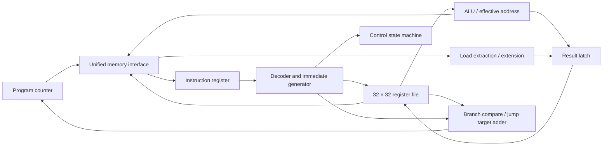
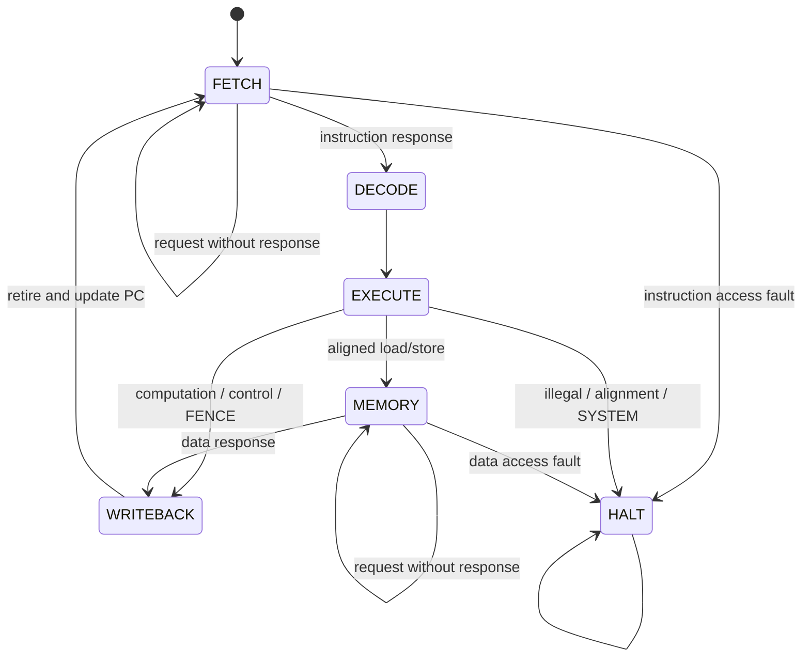

# Architecture and memory contract

OpenCore is a non-pipelined, little-endian 32-bit teaching core. Its synthesizable SystemVerilog has no delays, initial blocks, inferred simulation memory, DPI, or testbench code. Simulation proves behavior, not synthesis timing or area. No synthesis or FPGA implementation has been run.

## Architectural state

The PC resets to zero; all 32 integer registers reset to zero. x0 is hardwired to zero and discards writes. Arithmetic wraps modulo 2³². Register shifts use the low five shift-amount bits. Signed operations interpret 32-bit values as two’s complement. Instructions occupy four bytes (IALIGN=32).

The browser uses a functional datapath diagram. Branch comparators, the PC/target adder, immediate muxing, byte extraction and pending-address latches are collapsed into labeled paths. They are explicit expressions/latches in the RTL. Register arithmetic and load/store effective-address calculation use the ALU; target generation has its own adder. No claim of minimum hardware area is made.

## State machine

The decoder reads a latched instruction. Register operands remain stable because no register write occurs before writeback. Execution saves a result, next PC, and memory address/store operand as needed. Only writeback writes a general register and advances architectural PC. Stores become visible on the memory acknowledgement edge, one state before retirement; the in-order core cannot take another instruction between those edges. The external memory must not report an error after performing a write.

## Ports and protocol

| Port | Direction | Meaning |
| --- | --- | --- |
| `clk`, `reset` | input | Rising edge; synchronous active-high reset |
| `mem_valid` | output | One outstanding request exists |
| `mem_write` | output | 1 for data store; 0 for instruction/data read |
| `mem_addr[31:0]` | output | Word-aligned byte address, including fetch address |
| `mem_wdata[31:0]` | output | Store data shifted into selected little-endian byte lanes |
| `mem_wstrb[3:0]` | output | Byte enables; bit i writes address + i; zero for reads |
| `mem_ready` | input | Response/acknowledgement for current request, sampled at edge |
| `mem_rdata[31:0]` | input | Entire aligned word, valid when a read is acknowledged |
| `mem_error` | input | Fault instead of a successful acknowledgement; sampled with ready |

This is a **single request/response handshake**, not AXI and not separate acceptance/completion channels. A request completes exactly at an edge where valid and ready are both high. The core holds valid, address, write flag, data and mask stable while stalled. The responder must perform a successful store **once**, at completion, not on every cycle with valid high. Ignore data/error when ready is low; ignore ready when valid is low. Do not queue an additional copy of a held request. There is an internal state gap between requests. With no acknowledgement the core can wait indefinitely; there is no timeout.

The harness implements 64 KiB of byte-addressed RAM, zero-filled beyond the program image; this capacity belongs to the test environment, not the core. Out-of-range requests return access errors with no write. Reset cancels core state; an integrator must also reset/cancel outstanding responder transactions and prevent a write on reset. Debug/retirement outputs can be omitted in a production wrapper; their wide register visibility has hardware cost if preserved.

A latency of L means an acknowledgement on the **Lth edge with valid asserted**. L=1 has zero waiting cycles; L=2 has one; L=4 has three. Random tests choose a new delay of `L + rng() % (jitter+1)` per request, using C++ `std::mt19937` and the recorded seed.

## Trap environment

The project exposes terminal traps instead of implementing privileged CSRs, vectors, handlers or return instructions. On a trap, PC stays at the faulting instruction; no retirement pulse or link/register write is produced. `halted` stays asserted until reset; `trap_cause` and `trap_value` remain stable.

| Cause | Meaning | trap_value |
| --- | --- | --- |
| 0 | Misaligned taken branch/JAL/JALR target | Target address |
| 1 | Instruction access fault | Fetch address |
| 2 | Illegal/unsupported instruction encoding | Instruction bits |
| 3 | EBREAK | 0 |
| 4 / 6 | Misaligned load / store | Effective byte address |
| 5 / 7 | Load / store access fault | Effective byte address |
| 11 | ECALL, teaching environment convention | 0 |

Cause numbers follow familiar RISC-V exception numbering; exposing them does not implement machine mode. ECALL cause 11 is a chosen environment convention, not evidence of a privilege implementation. Untaken branches do not trap on a misaligned unused target. JALR clears bit 0 before checking alignment. Halfword/word misalignment traps before a data bus request. Loads to x0 still issue reads and still trap on faults. No memory access spans words. Illegal/reserved encodings terminate; unsupported extensions do too.

FENCE is legal for opcode 0x0f/funct3 000, with predecessor/successor, fm, rd and rs1 fields ignored: the single-outstanding, in-order interface has completed every earlier memory operation. This also safely strengthens FENCE.TSO to a full fence in this environment. No external devices, I/O reordering, multi-hart fabric or external observers are modeled. FENCE.I is an excluded Zifencei instruction and traps. ECALL and EBREAK do not retire.

## Trace sampling

Each JSONL record is one active clock edge after reset. `state`, `pc`, `insn`, ALU operands/output and bus signals describe values **before** that edge. `next_state`, `next_pc`, `regs`, retirement signals and trap outputs describe values **after** it. At FETCH the instruction latch still contains the previous instruction; the browser labels the assembly listing at PC as “fetching.” This is source metadata, not a newly latched instruction. `next_pc` is the architectural PC after the edge, not the internal pending target.

`retire_pc`, `retire_insn`, `retire_next_pc`, `rd`, and `rd_data` are meaningful when `retire=1`. A non-writing instruction or a write discarded by x0 reports zero rd_data. The browser highlights changed register values, so a write of an unchanged value does not highlight. Memory is reconstructed from initial bytes plus acknowledged stores, including the current edge. Debug ALU values are only semantically meaningful when the relevant datapath is selected.
