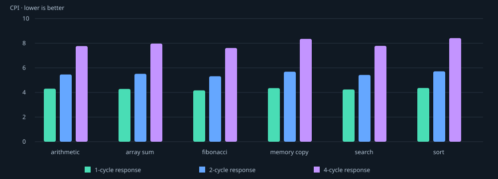

# Technical report: OpenCore Lab

## Question and scope

Can a small processor make the relationship between instruction semantics, clocked hardware and memory latency visible without disguising software animation as hardware? OpenCore combines a synthesizable multi-cycle RV32I teaching design, an actual RTL simulator, architectural differential checks and a static viewer of the simulator's recordings.

The design has all 40 base instruction mnemonics, with ECALL/EBREAK terminating in an exposed trap environment. It is not a privileged system and cannot boot an operating system. Naturally aligned memory operations are supported; misalignment traps. It excludes caches, pipelining, multiplication, CSRs, interrupts and FPGA integration. The instruction matrix defines the precise scope. No full-compliance claim follows from the tests.

## Design choices and alternatives

A single-cycle core would have a visually simple cycle boundary but would hide the cost of memory waiting and require a long combinational path. A pipeline would introduce hazards, bypasses and speculative control before the learner could isolate basic semantics. The multi-cycle design makes each transaction and state change explicit. Unified memory and one outstanding request avoid arbitration and transaction tags. The cost is limited throughput: even a register operation requires fetch, decode, execute and writeback.

A dedicated PC/branch-target adder simplifies control. The main ALU handles register computations and load/store effective addresses. A design reusing one adder might reduce area but would require different muxing/control; no area comparison was synthesized. Asynchronous register reads and synchronous writes are easy to understand but need synthesis-specific consideration on an FPGA.

Terminal exceptions provide deterministic behavior for unsupported instructions, misalignment and memory faults without pretending to implement machine-mode CSRs. FENCE is a serialized no-op because every earlier access has already completed. This reasoning applies to the documented memory contract and modeled environment, not an unimplemented multi-hart I/O system.

## Verification evidence

The recorded run used Verilator 5.052 2026-09-05 rev vUNKNOWN-built20260905 and Python 3.14.7. It passed **12,155 unit checks**, **75 processor regression runs**, and **2,234 instruction retirement comparisons**. The suite includes 15 arithmetic ADD vectors adapted from a pinned upstream `riscv-tests` file. All benchmark runs below also undergo retirement comparison but are counted separately from the regression totals.

An in-house instruction-at-a-time interpreter uses Python integer and byte-memory semantics, independently of the hardware FSM and decoder. At each retirement the runner compares PC, instruction, next PC, writeback result, all registers and the entire observed RAM. It checks trap state at termination. The memory harness rejects unstable or withdrawn requests while stalled, and the runner checks successful store counts to catch repeated writes with identical data. Algorithm-level expected outputs test the examples beyond agreement between two instruction implementations.

The random instruction-generation seeds are `[7, 42, 2026, 12648430, 3735928559]`. Those runs use a memory response delay of 2 plus a seeded random 0–5 cycles per request. Directed regressions cover all normally retiring supported mnemonics, all branch outcomes, signed/unsigned extremes, x0, legal memory lanes, forbidden encodings, faults and misalignment. This is functional test coverage, not exhaustive state-space exploration. The limited upstream vector adapter is not the upstream architectural harness, Spike, Sail, riscv-arch-test or official certification.

## Experiment method

Each of six programs runs from reset under fixed response latencies L=1,2,4. RAM is restored before every run; there is no cache or overlapping request. An acknowledgement arrives on the Lth edge for which the request is valid. Thus L=1 has zero stalled request cycles.

Measurement begins at the first active edge after synchronous reset is released and ends on the edge that asserts halted for the terminal EBREAK. Reset edges are excluded. EBREAK's fetch, decode and execute cycles are included; EBREAK itself does not retire. The same boundary is used for every run. No startup or display time is included. CPI is total measured cycles divided by successful retired instructions, so the denominator intentionally excludes EBREAK. Short-program CPI is correspondingly sensitive to the terminal overhead.

A waiting cycle is exactly an edge with `mem_valid && !mem_ready`, counting both instruction fetch and data accesses. This is not the whole time in a memory-request state: the response edge is excluded. If I instructions retire and D successful data operations occur, these terminating programs satisfy:

- Memory requests R = I + 1 + D, including the EBREAK fetch.
- Waiting cycles W = (L - 1) × R.
- Total cycles C = 4 × I + D + 3 + W.
- CPI = C / I.

The benchmark script measures every quantity from RTL traces and asserts these identities. The equation is a consistency check, not a replacement for simulation.

## Measured results

| Program | Latency | Retired | Total cycles | CPI | Waiting cycles |
| --- | ---: | ---: | ---: | ---: | ---: |
| arithmetic | 1 | 13 | 56 | 4.308 | 0 |
| arithmetic | 2 | 13 | 71 | 5.462 | 15 |
| arithmetic | 4 | 13 | 101 | 7.769 | 45 |
| array_sum | 1 | 35 | 150 | 4.286 | 0 |
| array_sum | 2 | 35 | 193 | 5.514 | 43 |
| array_sum | 4 | 35 | 279 | 7.971 | 129 |
| fibonacci | 1 | 88 | 367 | 4.170 | 0 |
| fibonacci | 2 | 88 | 468 | 5.318 | 101 |
| fibonacci | 4 | 88 | 670 | 7.614 | 303 |
| memory_copy | 1 | 99 | 431 | 4.354 | 0 |
| memory_copy | 2 | 99 | 563 | 5.687 | 132 |
| memory_copy | 4 | 99 | 827 | 8.354 | 396 |
| search | 1 | 33 | 140 | 4.242 | 0 |
| search | 2 | 33 | 179 | 5.424 | 39 |
| search | 4 | 33 | 257 | 7.788 | 117 |
| sort | 1 | 123 | 537 | 4.366 | 0 |
| sort | 2 | 123 | 703 | 5.715 | 166 |
| sort | 4 | 123 | 1035 | 8.415 | 498 |

At each latency, every program retires the same number of instructions. Increasing latency changes waiting, not the program's architectural result. Fibonacci goes from 367 to 670 cycles (1.826×) as response latency grows from 1 to 4. Its 101 requests each add three waiting cycles, explaining the 303-cycle increase exactly. Memory copy has 132 requests, so the same change adds 396 cycles, from 431 to 827 (1.919×). Its load and store per iteration make it more latency-sensitive than Fibonacci's single store per iteration. Sorting reaches CPI 8.415 at L=4 because its instruction mix contains frequent loads and swaps.

All programs slow down because instruction fetch also uses the same delayed interface. Comparing only data-memory operations would miss this dominant source of waits. The experiment does not estimate clock frequency, dynamic energy, power, FPGA utilization, instruction-cache effects, a pipelined processor's behavior, or real DRAM timings. One uniform fixed response delay is an educational abstraction. No wall-clock simulation runtime is treated as processor execution speed.

## Browser and provenance

The default demo is read-only playback of the six real latency-2 RTL traces. Each trace records pre-edge control/bus signals and post-edge architectural registers. The browser reconstructs the relevant 128 data-memory bytes using acknowledged writes and highlights changed register values. The functional diagram folds some muxes, comparison and address logic into labeled paths, while displaying sampled values from the actual trace. Assembly listings are metadata; during fetch they preview the requested instruction and are labeled accordingly.

Program selection, play/pause, reset, cycle stepping, instruction-retirement stepping, speed and timeline controls work entirely in the browser. The static build uses no external services, API keys, runtime packages or fonts. `tools/check_artifacts.py` binds the displayed files to measured results using counts, embedded assembly, copy comparisons and SHA-256 manifest entries. Browser and clean-rebuild observations are recorded separately so they are not mistaken for architectural evidence.

## Limitations and next work

The reference model was authored with the RTL in this AI-assisted project, so common interpretation errors remain possible. The upstream evidence currently covers only basic ADD vectors. There is no formal proof, complete external architectural suite, interrupt architecture, system-level memory-ordering experiment, mid-transaction reset validation, synthesized timing/area analysis or physical hardware deployment. GitHub CI is configured but remote runs require publication.

The most valuable next verification step is to expose RVFI or build a Spike/Sail comparison with precise treatment of the terminal environment. The most instructive performance extension is to separate instruction/data delay parameters and test whether the request-count equation still explains measured changes. Pipelining or caches should follow those stronger checks, not substitute for them.

## Sources

- [RISC-V RV32I version 2.1](https://docs.riscv.org/reference/isa/v20260120/unpriv/rv32.html): instruction and alignment semantics.
- [Pinned upstream ADD tests](https://github.com/riscv-software-src/riscv-tests/blob/d7e86f701b929b5d801f8cda1a4871ab05f452bb/isa/rv64ui/add.S): externally authored arithmetic vectors; retained BSD license.
- [Verilator documentation](https://verilator.org/guide/latest/overview.html): RTL compilation/simulation tool.
- Repository `results/benchmark.json`, `results/verification.json` and `demo/data/manifest.json`: measured project evidence.
